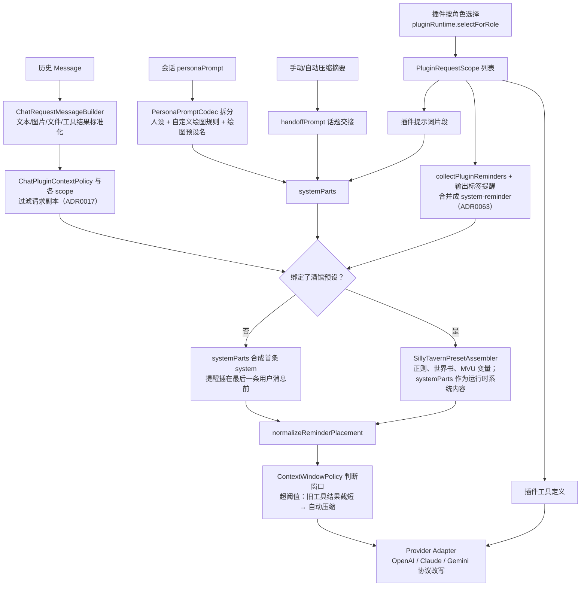

# 提示词装配链路

> 更新日期：2026-10-16（按当时代码重写。旧版写于 2026-04，其中的旧装配器 `chat_request_builder.dart`、视觉描述回退、记忆插件 pre-flush 均已删除）
> 适用范围：`apps/aicove_flutter/` 聊天主链路、旁路 Agent 链路与上下文预览

## 1. 一句话结论

一次聊天请求的唯一装配入口是 `ChatSendBackendService.prepareApiConfig()`（`lib/src/features/chat/services/chat_send_backend_service.dart`，实现在私有的 `_prepareApiConfig`）。前台聊天、后台主动回复、语音通话、上下文预览都走它，差异只在参数（ADR0060）。

## 2. 主链路总览

## 3. 各层说明

### 3.1 角色人设

`conversation.personaPrompt` 是混合字段，由 `features/chat/domain/persona_prompt_codec.dart` 拆成：用户人设、自定义绘图规则、绑定的绘图工具预设名、画师预设名。内置角色的原始人设在 `assets/characters/prompts/`，由 `features/chat/data/preset_characters_loader.dart` 载入。

绑定了酒馆预设时，人设不直接进 `systemParts`，而是作为预设里的角色描述交给预设装配（ADR0010）。

### 3.2 话题交接

手动压缩（翻篇）和自动压缩（腾地方）的摘要合成 `handoffPrompt`，放进 `systemParts`。摘要只是派生笔记，原文不变（ADR0038）。

### 3.3 消息标准化

`features/chat/services/chat_request_message_builder.dart` 把 `Message` 列表转成请求消息：

1. 文本、图片、文件、工具结果统一转成请求格式，相邻的 assistant 文本合并。
2. 模型不支持视觉时，图片改用它已有的文字描述（生成提示词）代替，不再调用单独的视觉描述模型（ADR0023）。
3. 历史里 AI 生成的图片整理成内部图片上下文；出现时主链路额外加一条保护规则，避免模型把它当成新的生图指令。

### 3.4 插件

插件按角色选择（ADR0035），每个插件在本次请求里得到一个 `PluginRequestScope`（`features/agent_plugins/plugin_request_scope.dart`），能贡献三样东西：

| 贡献 | 去向 |
|---|---|
| 提示词片段 `prompt()` | 经 `ChatPluginContextBuilder` 收集，记录注入／未注入原因，进 `systemParts` |
| 工具 `tools` | 模型支持工具调用时收集成 schema，scope 还可改写 schema |
| 请求前提醒 `reminders()` | `collectPluginReminders` 按顺序合并，出错的插件跳过（ADR0063） |

标签与工具的说明全局一份（ADR0054），由 `pluginPromptsProvider` 提供，覆盖预设与插件配置里的旧副本。

### 3.5 请求副本过滤

`ChatPluginContextPolicy` 按本轮生效插件过滤请求副本：插件关闭时删掉对应标签、内部正文和成对的工具调用与结果；用户上传的附件和标签外文字保留。过滤在消息标准化后、预设装配后、最终放置前各做一次。raw、blocks、预设和摘要原文都不改（ADR0017）。

### 3.6 system-reminder

提醒内容来自插件（时间感知、绘图失败等）和本轮输出标签提醒（`chat_output_tag_reminder.dart`，按启用的绘图／语音／预设标签提示可用标签）。它们由 `SystemReminderService`（`lib/src/core/services/system_reminder_service.dart`）合并成一条 `<system-reminder>`，以 `role=user` 插在最后一条用户消息之前；绑定预设时作为受保护的运行时消息交给预设装配。最后统一经 `normalizeReminderPlacement` 修正位置。主动回复预生成时提醒按「发送时刻」计算。

### 3.7 酒馆预设

绑定预设时由 `SillyTavernPresetAssembler`（`features/agent_context/domain/`）装配：显示正则、世界书扫描（只注入 raw 派生副本）、预设变量与 MVU 状态（ADR0071），`systemParts` 作为运行时系统内容放进预设指定的位置。没有绑定预设时，`systemParts` 直接合成首条 `role=system` 消息；全部为空时不生成 system 消息。

### 3.8 窗口与压缩

`ContextWindowPolicy`（`features/context/domain/context_window_policy.dart`）按设置的窗口、模型窗口和输出预留（预设的 `maxOutputTokens`，默认 2048）算出触发线。超过触发线时：

1. `RuntimeContextService.pruneToolResults` 先把超过 8192 字符的工具结果截成「头 4096＋尾 1024」（ADR0061 改为按时间清理，未实施）。
2. 仍超线则做自动压缩；工具循环中的运行时压缩只改下一次请求，不落库。

### 3.9 Provider 协议适配

内部统一按 OpenAI 风格装配，再由 `lib/src/core/api/providers/` 下的适配器改写：OpenAI 直接用 `messages`；Claude 把 system 抽成顶层 `system`；Gemini 抽成 `systemInstruction`，`<system-reminder>` 留在 user contents。

## 4. 旁路链路

| 链路 | 入口 | 与主链路的关系 |
|---|---|---|
| 压缩 | `features/context/data/background_context_summarizer.dart` | 后台 Agent，不装配角色卡、插件或工具，输入只来自原文快照 |
| 长期记忆整理 | `features/memory/data/background_memory_agent_adapter.dart` | 后台记忆 Agent，只有一个只读检索工具；聊天时由记忆插件注入常驻层与检索到的档案层（ADR0038） |
| 主动回复 | `features/auto_reply/` | 判断题由判断模型回答；预生成走主链路 `prepareApiConfig`，见 主动关怀系统/README.md |
| 语音通话 | `features/voice_call/` | 接通时调用 `prepareApiConfig` 拿一份快照，只保留记忆和时间感知插件（ADR0074） |
| 增强生成 | `features/chat/data/enhanced_dialogue_service.dart` | 独立的增强 system prompt，只带最近几轮，从 `<enhance>` 提取结果 |

## 5. 看真实的最终请求

「调试 → 联系人上下文」（`lib/src/ui/features/debug/pages/contact_context_page.dart`）调用 `ChatSendBackendService.previewContext`，和真实发送共用同一套装配，只跳过补摘要、自动压缩、会话变量写回与追踪落盘，不发请求。能看到最终 messages、系统提示词来源拆分、插件注入与未注入原因、工具定义、估算 token 与压缩阈值。

已发生请求的历史版本看 trace payload（`chat_send_trace_payload_builder.dart`），导出方式见 `apps/aicove_flutter/tool/DIAGNOSTICS.md`。

线上表现和预期不一致时，按这个顺序排查：

1. 插件是否对这个角色生效，提示词是否注入（预览页的「未注入原因」）。
2. 请求副本过滤是否删掉了你期待的标签或工具对。
3. 有无绑定预设：预设路径下 system 内容的位置由预设决定。
4. system-reminder 的位置。
5. 是否触发了工具结果截短或自动压缩。
6. Provider 适配器的协议改写。

## 6. 历史

旧版的问题清单与分批改造方案已归档：[提示词工程实施方案](../05_历史归档/20261016_文档库修订/提示词工程实施方案.md)。`core/services/prompt_tag_semantics_service.dart` 里旧的「统一标签语义汇总」已不在主链路调用（2026-09-11 起标签说明归属各插件，后由 ADR0054 改为全局一份）。
